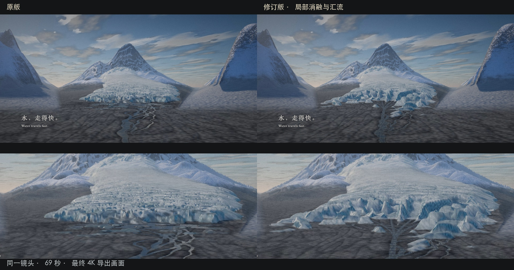
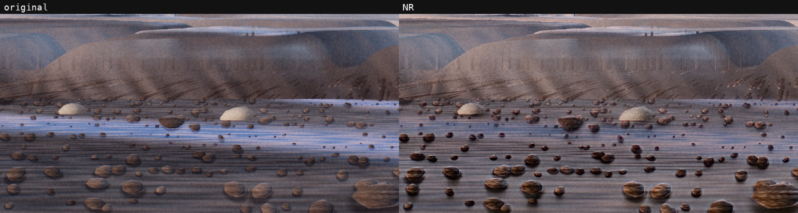

# 一粒 / GRAIN

一部完全由代码生成的 4 分钟 3D 动画，以及把它做成 **4K、18:9 成片**的完整实践：场景建模、镜头、材质、程序配乐、融雪流水修订、MLX-DLSS 局部增强和导出验收。

*A four-minute procedural Three.js film, with its source, rendering tools and a documented MLX-DLSS enhancement case study.*



## 这里有什么

- **影片源码**：山谷、冰川、石块、河流、种子与树；22 个镜头，固定时间线和程序生成材质。
- **声音源码**：WebAudio 合成的音乐与环境音，附融雪段修订思路。
- **渲染工具**：实时浏览、单帧、短片、完整 MP4、单文件 HTML；Apple Silicon 可使用 VideoToolbox 硬件编码。
- **增强流程**：在 grain 之前处理干净画面，按镜头运行一层或两层 NR，再恢复原 grain；保留参数、失败案例和实际限制。
- **制作经验**：18:9 构图、白场保护、色彩与编码头、局部声音补丁、逐帧验证、可回退工程与缓存清理。

不需要拍摄素材、贴图包或预制三维资产即可运行基础影片。MLX-DLSS 是可选的离线后处理，需要另外准备兼容的运行时与模型。

## 先跑起来

需要 Node.js 22.12+。离线渲染还需要支持硬件 WebGL2 的 Chrome/Chromium，以及 PATH 中的 FFmpeg/ffprobe。

```bash
npm ci
npm run serve
```

打开终端显示的本地地址，点击播放。空格暂停，左右方向键跳转，`f` 全屏，`h` 显示状态。程序画面并不包含离线 NR 结果。

导出一段 18:9 预览：

```bash
node tools/render.mjs --start 65 --end 67 --scale 0.5 \
  --crop 960:480:0:30 --samples 2 --preset veryfast \
  --out out/glacier-preview.mp4
```

Apple Silicon 上导出完整 4K / 18:9 基础影片：

```bash
node tools/render.mjs --scale 2 --samples 8 \
  --crop 3840:1920:0:120 \
  --encoder hevc_videotoolbox --quality 75 \
  --out out/grain-4k-18x9.mp4
```

内部画布仍是 16:9，镜头与 2:1 有效画面已经配合调整；以上裁切移除留边，输出文件本身没有固定黑边。不要简单改内部宽高来替代构图调整。

```bash
npm run build
# 生成 out/film.html，可在桌面浏览器本地打开
```

更多运行条件、浏览器路径与音频差别见 [影片与导出](docs/film.md)。标准基础片渲染不等于历史交付 MP4 的逐字节重建：浏览器、GPU、字体与声音母带流程可能产生差异。

## MLX-DLSS 实测

这里使用 [社区 MLX-DLSS](https://github.com/iamwavecut/MLX-DLSS) 的 RGB 神经渲染适配。它使用估计光流和常量深度，**不是 NVIDIA 官方引擎 DLSS 接入**，也没有真实场景法线、材质或深度缓冲。

| 镜头 | 单次强度 detail / colour | 层数 | 主要收益 |
| --- | --- | --- | --- |
| S06 · 远景碎石与山体 | 3 / 1.5 | 1 | 接触阴影、局部反差 |
| S10 · 白天山景 | 1.8 / 1.1 | 1 | 山岩明暗层次 |
| S11 · 崩塌与尘雾 | 1 / 1 | 2 | 岩雪反差的小幅改善 |

共同使用 standard、intensity=1、processing-scale=1。不能将这些结果描述成生成了可信的新裂纹或地质结构；原有造型的问题仍需要回到 3D 场景解决。



从 [DLSS 使用说明](docs/dlss.md) 与 [复现步骤](docs/reproduction.md) 开始。仓库提供调用代码与 PNG 序列入口补丁；不包含模型权重、NVIDIA 二进制、提取器或整棵上游实现。

## 读经验与代码

| 文档 | 内容 |
| --- | --- |
| [影片与导出](docs/film.md) | 从实时预览到 18:9 导出 |
| [引擎结构](docs/architecture.md) | 绝对时间、场景、渲染与声音组织 |
| [故事与镜头](docs/story.md) | 故事、分镜、节奏与声音设计 |
| [局部声音修复](docs/audio.md) | 重建混音、固定增益与只改局部 PCM |
| [制作复盘](docs/lessons.md) | 哪些提升有效，哪些出了问题，为什么这样修 |
| [DLSS 使用说明](docs/dlss.md) | 参数、分层、grain、序列状态与边界 |
| [复现步骤](docs/reproduction.md) | 安装外部依赖、短样与完整镜头处理 |
| [验收记录](docs/validation.md) | 历史交付与开源包实测的区别 |

## 许可与来源

本项目原创代码、文档与示例图采用 [MIT License](LICENSE)。第三方代码、算法实现与补丁的许可和署名见 [THIRD_PARTY_NOTICES.md](THIRD_PARTY_NOTICES.md)，不由本项目重新授权。MLX-DLSS 的模型和 NVIDIA 软件不包含在本仓库许可内。

本片以人类创作方向与审片为依据，使用 AI 编程代理协作实现。公开内容经过构建、短片渲染及独立代码审查；具体检查范围以验收记录为准。
