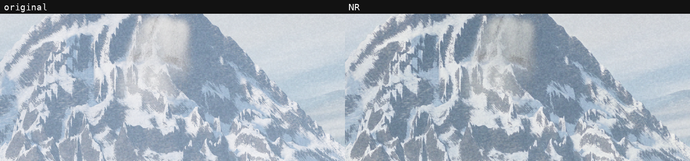
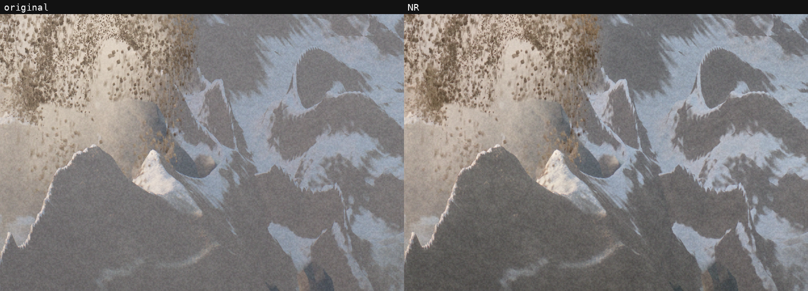
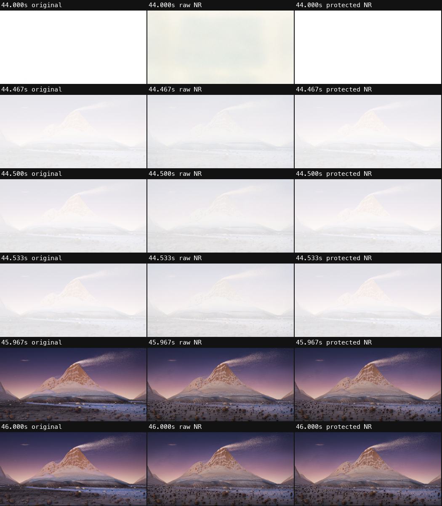

# 从程序动画到可交付影片：这次实际学到了什么

这是一部 240 秒、30 fps 的程序生成短片。以下结论来自这一部片子的实测；不是所有镜头、模型或硬件的通用最优参数。

## 先修结构，再谈增强

最早的水像一条亮色带子，冰川像整块向后退。我们先修改 Three.js 场景：冰体在固定世界坐标中局部变薄，前缘分成不同的冰舌，碎冰留在原处继续消融；水从分支汇入原河道，反光被打散。这样才改变了动作与空间关系。

这是 3D 场景的修订，不能算作 DLSS 的功劳。融雪声音也单独修改：取消没有对应画面事件的低频重击，减弱带明显音高的气泡/啸叫，以连续浅流水承接镜头。主观声音审美与音轨完整性检查是两回事。

## DLSS 在这里具体改了什么

本项目使用社区 MLX-DLSS 的 RGB 神经渲染，配估计光流与常量深度。它没有接入真实的场景 depth、normal 或材质数据，也不是 NVIDIA 官方引擎集成。

| 镜头 | 时间 | 层数 | detail / colour | 观察 |
| --- | --- | --- | --- | --- |
| 远景碎石与山体 S06 | 44–58 s | 1 | 3 / 1.5 | 接触阴影与局部反差更明显，石头的圆形几何与横纹仍在 |
| 白天山景 S10 | 82–96 s | 1 | 1.8 / 1.1 | 山岩阴影更清楚，雪面与云形保持；增益相对克制 |
| 崩塌与尘雾 S11 | 96–102 s | 2 | 每层 1 / 1 | 岩雪边缘反差略增强，尘雾保留；没有证据表明补出了可信岩层 |

共同参数为 standard、intensity=1、scale=1、float16、temporal on、automatic motion。intensity 超过 1 会被此实现钳制，继续加大数字无效。双层意味着完整第一层的输出成为第二层输入，不是把一张增强图叠两次。

静态对比能显示纹理与反差，但不能证明视频的时间稳定性。实际还检查了各镜头多时点连续画面，以及片头文字、粒子、雪线、尘雾和运动边缘。

## Grain 放在最后

顺序为：干净的 display-sRGB 场景帧 → NR 第一层 → 可选 NR 第二层 → 按原绝对帧恢复 grain → 导出。干净帧仍包含原有 tone mapping、景深、字幕和粒子；它不是线性 HDR G-buffer。

每个镜头单独重置历史。双层各自拥有完整的序列、历史和光流，不把上一镜头的状态带进下一镜头，也不在两层之间添加 grain。绝对帧号和画幅必须保持，否则颗粒尺寸、位置或随机种子会变。

## 强度高时，转场比石块先出问题

S06 开头原本接近纯白，模型却把它压暗染黄。同域 RGB 的平均绝对差约 19.35/255。处理办法是 44–44.5 s 保留原画面，44.5–46 s 平滑进入增强，46 s 后全增强。保护发生在最后恢复 grain 后的同域 RGB，不重复推理。

这也是为什么不能用一张最好看的静帧替代完整镜头验收。

## 18:9 需要重看构图

本片最初在 16:9 内加黑边。切成真正的 18:9 输出后，需要重新检查树冠与山脊的对应、地面覆盖以及字幕位置。当前代码保留为这套构图调整过的场景；内部 16:9 渲染再裁出 2:1 有效画面。直接修改渲染器宽高会改变投影，并不等价。

## 编码头比文件扩展名更重要

一次 S08 用 VideoToolbox q70 导出，其他段是 q75。虽然都叫 HEVC/hvc1、分辨率相同，PPS 却不同，不能在单一 hvcC 下直接复制拼接。最后将 S08 以同一 q75 配置重导，并严格比较实际编码头。

PNG 的 ICC 元数据也曾干扰输出颜色标签。最终沿用原成片的 BT.709 limited 标签与像素约定，明确删除干扰的 ICC side data。标签改对不等于做了新的色彩转换；不能把已编码 RGB 再随意进行一次传递函数转换。

## 验收分四层

1. 配置：参数、色彩与码率设置写对了。
2. 运行：确实生成了预期帧数，日志没有失败。
3. 成品：实际解码，核对画幅、PTS、接点、声音和时间稳定性。
4. 观看：连续画面的美感与声音是否贴合，仍需审片。

历史交付为 3840×1920、7200 帧、240 秒。修改 43 秒，其中 NR 为 34 秒、融雪场景为 9 秒；其余 5910 帧的压缩包直接与原完整影片逐一相同。七处接点的前一帧、新段首帧、下一帧共 21 帧，解码 RGB 与各自来源一致，全片解码无错。该数字描述当时交付；开源后的重新渲染不承诺跨机器字节一致。

音频修订固定原 master gain，在 65–78 s 做局部 PCM 补丁，边界平滑；窗外样本原样保留。不能在改一点水声后重新归一化整片响度，再声称其他段声音未变。

## 缓存与复现

这次所有逐帧处理一度把实验目录推到约 203 GiB。保留源码、参数、最终片段、对照图和校验记录后，清掉可重建缓存，目录降到约 10 GiB。工作目录应放在有足够空间的本地磁盘，避免每个中间 PNG 都触发云盘同步。

原稿、接受的修订与公开源码分开保存。Git 可以回退源码；未入 Git 的帧缓存必须重渲，不能把两者混为一谈。
